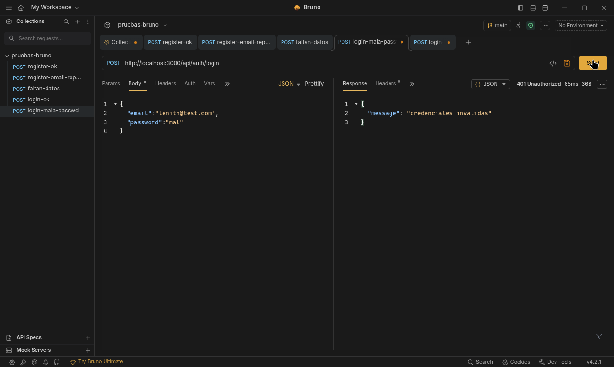

# Módulo de Autenticación con JWT

**Alumno:** Lenith · **Rolling Code School** | Comisión Web24

Módulo de registro e inicio de sesión de usuarios para la API de Tareas, con **Node.js + Express + MongoDB (Mongoose)**, contraseñas hasheadas con **bcrypt** y sesión mediante **JWT**.

---

## Endpoints

| Método | Ruta | Descripción |
|--------|------|-------------|
| `POST` | `/api/auth/register` | Crea un usuario (la contraseña se guarda hasheada) |
| `POST` | `/api/auth/login` | Valida credenciales y devuelve un token JWT |

---

## Pruebas (Bruno)

### 1. Registro exitoso → `201 Created`



### 2. Login exitoso → `200 OK` con token JWT


> Los otros 4 casos (email repetido `409`, datos faltantes `400`, contraseña incorrecta `401` y email inexistente `401`) están en `bruno-screenshots/` y en la colección `pruebas-bruno/`, lista para abrir con Bruno.

---

## Cómo correrlo

```bash
npm install
cp .env.example .env   # completar PORT, MONGO_URI y JWT_SECRET
npm run dev
```
