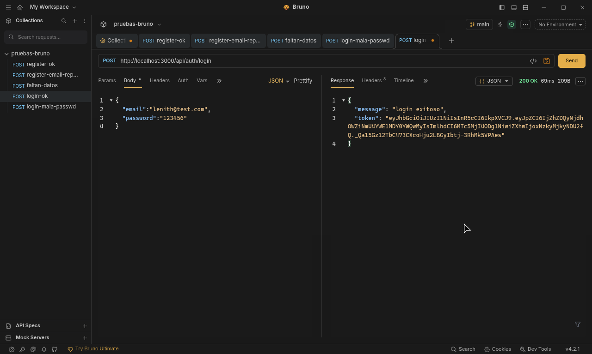
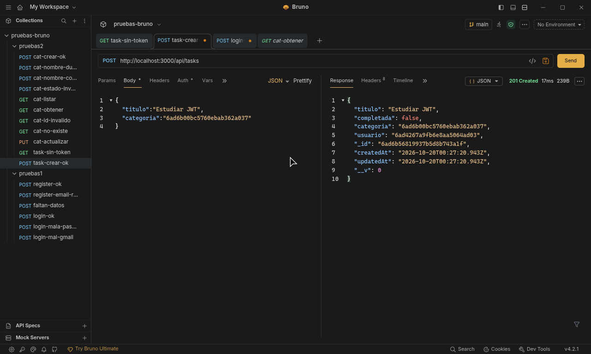

# API de Tareas con Autenticación, Categorías y Validaciones

<picture>
  <source media="(prefers-color-scheme: dark)" srcset="assets/banner-blanco.png">
  
</picture>

API REST desarrollada con Node.js, Express y MongoDB (Mongoose). Incluye registro e inicio de sesión con JWT, CRUD de categorías, CRUD de tareas asociadas a categorías y al usuario autenticado, y validación de datos con express-validator.

## Instalación

```bash
npm install
cp .env.example .env
npm run dev
```

Variables de entorno:

| Variable | Descripción |
|----------|-------------|
| `PORT` | Puerto del servidor |
| `MONGO_URI` | Cadena de conexión a MongoDB |
| `JWT_SECRET` | Clave para firmar los tokens |

## Estructura

```
src/
  config/        conexión a la base de datos
  models/        User, Category, Task
  controllers/   lógica de cada recurso
  routes/        auth, categories, tasks
  middlewares/   auth.js, validators.js
pruebas-bruno/   colección de pruebas
assets/          logo y capturas de las pruebas
```

## Endpoints

| Método | Ruta | Token |
|--------|------|:-----:|
| POST | `/api/auth/register` | No |
| POST | `/api/auth/login` | No |
| GET | `/api/categories` | No |
| GET | `/api/categories/:id` | No |
| POST | `/api/categories` | No |
| PUT | `/api/categories/:id` | No |
| DELETE | `/api/categories/:id` | No |
| GET | `/api/tasks` | Sí |
| GET | `/api/tasks/:id` | Sí |
| POST | `/api/tasks` | Sí |
| PUT | `/api/tasks/:id` | Sí |
| DELETE | `/api/tasks/:id` | Sí |

Las rutas de tareas requieren el header `Authorization: Bearer <token>`. Cada usuario solo accede a sus propias tareas.

## Ejemplos

**Login** — `POST /api/auth/login`

```json
{ "email": "lenith@test.com", "password": "123456" }
```

Respuesta `200`:

```json
{ "message": "login exitoso", "token": "eyJhbGciOi..." }
```

**Crear categoría** — `POST /api/categories`

```json
{ "nombre": "Trabajo", "estado": true }
```

Respuesta `201`:

```json
{ "_id": "6ad6b00bc5760ebab362a037", "nombre": "Trabajo", "estado": true }
```

**Crear tarea** — `POST /api/tasks`

```json
{ "titulo": "Estudiar JWT", "categoria": "6ad6b00bc5760ebab362a037" }
```

Respuesta `201`: la tarea creada, con `completada: false` y el `usuario` del token.

**Error de validación** — `400`:

```json
{
  "message": "error de validacion",
  "errores": [{ "campo": "titulo", "mensaje": "el titulo es obligatorio" }]
}
```

## Validaciones

- Categoría: `nombre` obligatorio, texto, de 3 a 50 caracteres y único; `estado`, si se envía, booleano.
- Tarea: `titulo` obligatorio; `descripcion`, `fechaEntrega` (ISO) y `completada` opcionales; `categoria` opcional, debe ser un ObjectId válido y existir.
- Los ids en la URL deben ser ObjectId válidos.

Códigos de respuesta: `200` y `201` en éxito, `400` por validación, `401` por token o credenciales inválidas, `404` si el recurso no existe, `409` por duplicados.

## Pruebas

La colección de Bruno está en `pruebas-bruno/` (carpetas `pruebas1` para autenticación y `pruebas2` para categorías y tareas). Todas las capturas están en `assets/`.

Login exitoso (`200`):



Creación de tarea con token (`201`):


